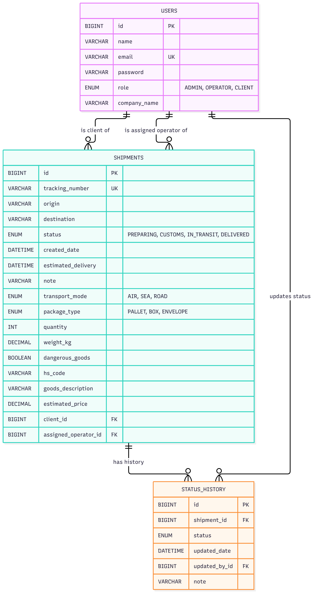
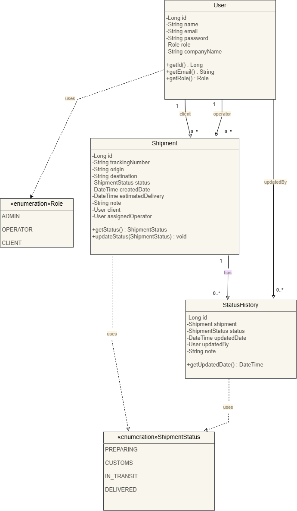

# Cargofy — Backend

> REST API for **Cargofy**, a web application to track international shipments. Final capstone project of the Factoría F5 Full Stack Development Bootcamp.

Cargofy is an internal control tool for a company that manages its own import/export shipments. Clients follow the status of their shipments, operators create shipments and update their status, and each status change is stored in a timeline (status history). The backend is built with **Spring Boot** and **Spring Security** (JWT), with a **dockerized MySQL** database.

## Table of Contents

- [Prerequisites](#prerequisites)
- [Installation](#installation)
- [Usage](#usage)
- [Database and Class Diagrams](#database-and-class-diagrams)
- [Endpoints](#endpoints)
- [Project Structure](#project-structure)
- [Running Tests](#running-tests)
- [Tools](#tools)
- [Known Issues](#known-issues)
- [Future Improvements](#future-improvements)
- [Project Links](#project-links)
- [Author](#author)

## Prerequisites

- Java 21
- Docker and Docker Compose
- Git

Maven is not required: the project includes the Maven wrapper (`mvnw`).

## Installation

```bash
git clone https://github.com/Raana-1375/f5-digital-academy-cargofy-backend.git
cd f5-digital-academy-cargofy-backend
```

### Database

The MySQL 8.0 database runs in a Docker container (`cargofy-mysql`, database `cargofy_db`, port 3306). From the project folder:

```bash
docker compose up -d
```

The connection settings are in `src/main/resources/application.properties`.

### Environment variables (optional)

The application works out of the box for local development. In production, override these values:

| Variable | Description | Default |
|---|---|---|
| `JWT_SECRET` | Base64 key used to sign the JWT tokens (at least 256 bits) | development key in `application.properties` |
| `CORS_ALLOWED_ORIGINS` | Frontend origin allowed to call the API | `http://localhost:5173` |

To generate a new JWT key:

Windows (PowerShell):

```powershell
[Convert]::ToBase64String([byte[]](1..32 | ForEach-Object { Get-Random -Maximum 256 }))
```

Linux or Mac:

```bash
openssl rand -base64 32
```

Tokens are valid for 24 hours (`jwt.expiration`).

## Usage

Make sure the database container is running, then:

```bash
./mvnw spring-boot:run
```

On Windows PowerShell use `./mvnw spring-boot:run` as well. The API is available at `http://localhost:8080`.

To try it, register a user (`CLIENT` or `OPERATOR`) with `POST /api/auth/register` and send the returned token in the `Authorization: Bearer <token>` header.

## Database and Class Diagrams

### Entity-relationship diagram



### Class diagram



## Endpoints

Base URL: `http://localhost:8080`. All endpoints except `/api/auth/**` require the header `Authorization: Bearer <token>`.

Errors always return the same JSON body: `status`, `error`, `message`, `timestamp` (and `errors` with the field messages on validation failures).

### Authentication

| Method | Endpoint | Access | Description |
|---|---|---|---|
| POST | `/api/auth/register` | Public | Create an account. Role must be `CLIENT` or `OPERATOR` (`ADMIN` is rejected with 400) |
| POST | `/api/auth/login` | Public | Log in and receive a JWT token |

### Shipments

| Method | Endpoint | Access | Description |
|---|---|---|---|
| GET | `/api/shipments` | Authenticated | List shipments. Optional `status`, `page` (default 0) and `size` (default 10) |
| GET | `/api/shipments/{id}` | Authenticated | Shipment detail with its status history |
| POST | `/api/shipments` | OPERATOR, ADMIN | Create a shipment (starts as `PREPARING`). Optional `clientId`, `assignedOperatorId`, `estimatedDelivery` and `note` (max. 300 characters) |
| POST | `/api/shipments/{id}/status` | OPERATOR, ADMIN | Update the status and add a note to the history |

### Users

| Method | Endpoint | Access | Description |
|---|---|---|---|
| GET | `/api/users?role=CLIENT` or `OPERATOR` | OPERATOR, ADMIN | List users (`id`, `name`, `companyName`) for the New Shipment form |
| PUT | `/api/users/{id}` | Authenticated (own profile) | Update name, email and company name. Returns the user and a new token |
| PUT | `/api/users/{id}/password` | Authenticated (own account) | Change the password. Requires the current password |

### Dashboard

| Method | Endpoint | Access | Description |
|---|---|---|---|
| GET | `/api/dashboard/summary` | Authenticated | Totals by status and the 5 most recent shipments. A `CLIENT` only sees their own shipments |

### Error codes

| Code | When |
|---|---|
| 400 | Validation errors, malformed body, invalid or missing parameters, wrong current password |
| 401 | Wrong email or password |
| 403 | The role is not allowed or the resource belongs to another user |
| 404 | Resource not found |
| 409 | Email already in use |

## Project Structure

```
f5-digital-academy-cargofy-backend/
│
├── src/
│   ├── main/
│   │   ├── java/com/cargofy/backend/
│   │   │   ├── config/        # Security and CORS configuration
│   │   │   ├── controller/    # REST controllers (HTTP layer)
│   │   │   ├── dto/           # Request and response objects
│   │   │   ├── exception/     # Custom exceptions and global error handler
│   │   │   ├── model/         # JPA entities and enums
│   │   │   ├── repository/    # Spring Data repositories
│   │   │   ├── security/      # JWT service, filter and user details
│   │   │   ├── service/       # Business logic
│   │   │   └── CargofyBackendApplication.java
│   │   └── resources/
│   │       └── application.properties
│   └── test/                  # Tests
│
├── docker-compose.yml         # MySQL container
├── pom.xml                    # Maven dependencies
└── README.md
```

The code follows a layered architecture: **Controller → Service → Repository**. Controllers only handle HTTP; the business rules live in the services.

## Running Tests

```bash
./mvnw test
```

Unit tests (services) and integration tests (endpoints) are being added.

## Tools

- Java 21, Spring Boot, Spring Security, Spring Data JPA (Hibernate)
- JWT (JJWT)
- MySQL 8.0 and Docker
- Maven and Lombok
- Visual Studio Code
- Jira (project planning), Figma (design), draw.io (diagrams)

## Known Issues

- `GET /api/shipments` and `GET /api/shipments/{id}` return all shipments to any authenticated user. Restricting them to the shipments of the client is planned.
- There is no admin account created automatically yet.
- Any visitor can register as `OPERATOR`, as shown in the design of the Create Account page.

## Future Improvements

- Restrict the shipment list and detail to the shipments of the logged-in client
- Create an initial admin account when the application starts
- Search shipments by tracking number
- Unit and integration tests, and API documentation with Swagger

## Project Links

- Frontend repository: [f5-digital-academy-cargofy-frontend](https://github.com/Raana-1375/f5-digital-academy-cargofy-frontend)
- Presentation: _link coming soon_

## Author

**Rana** — [@Raana-1375](https://github.com/Raana-1375)