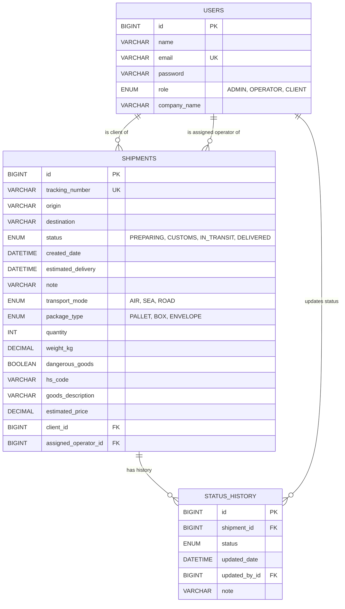
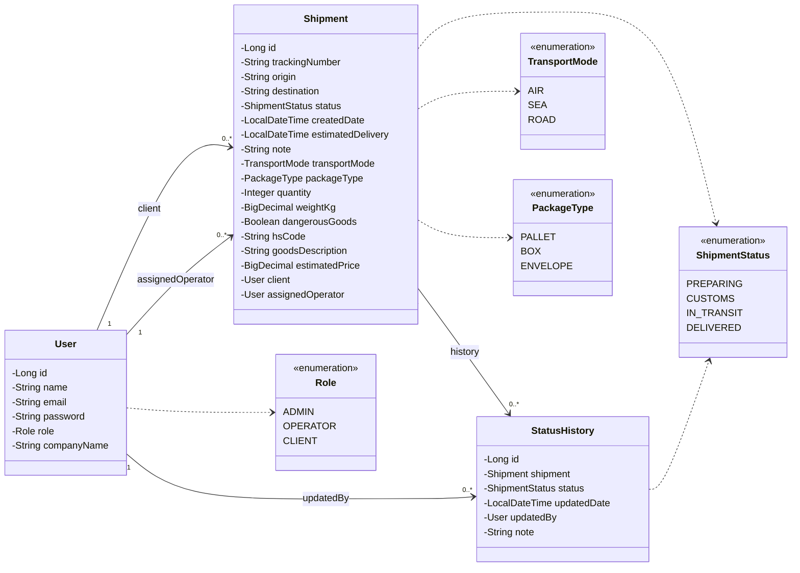
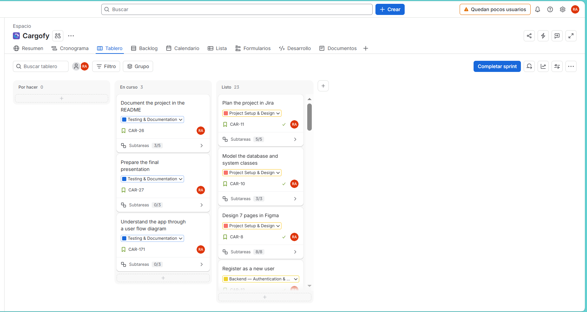
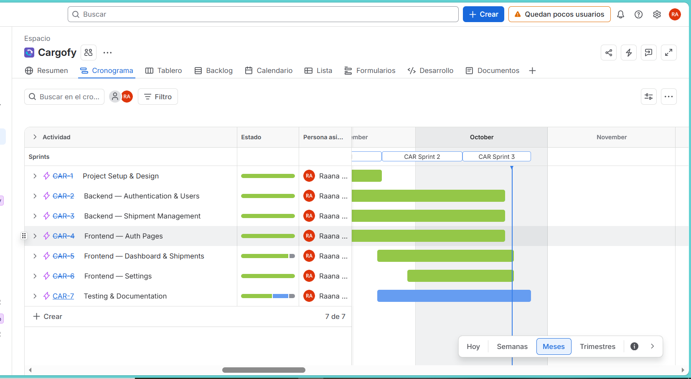
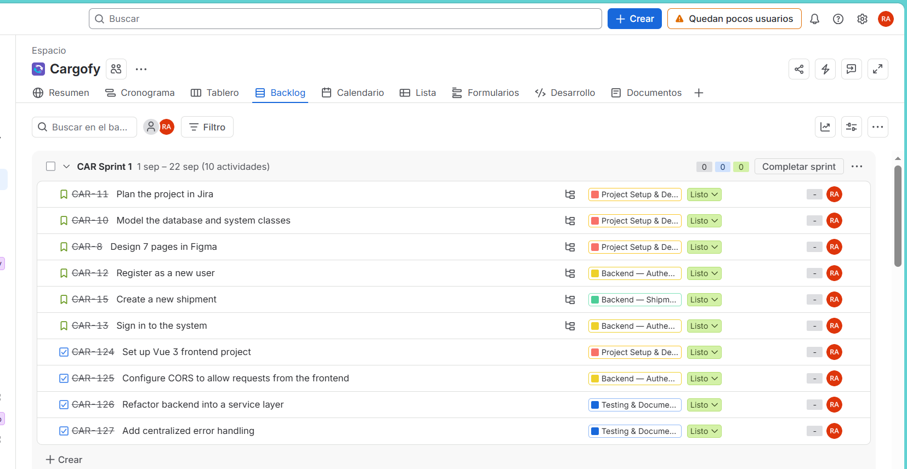
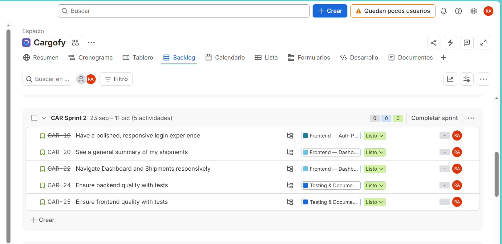
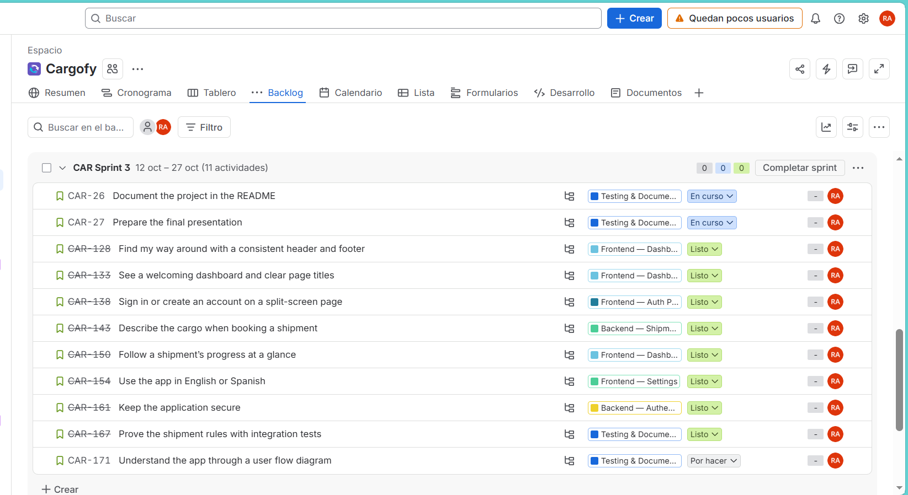
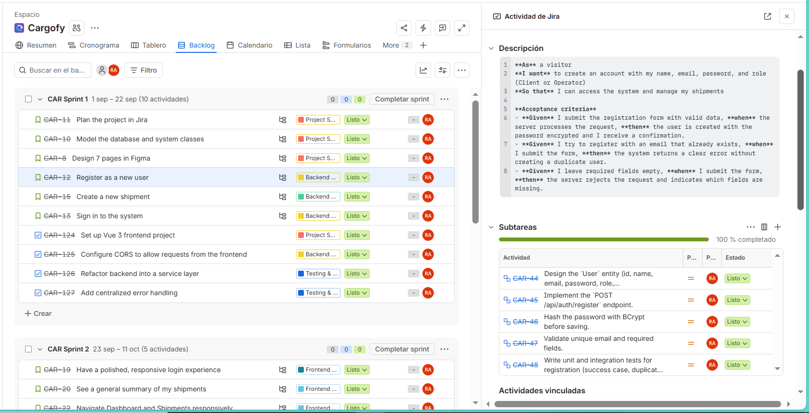

# Cargofy — Backend

> REST API for **Cargofy**, a web application to track international shipments. Final capstone project of the Factoría F5 Full Stack Development Bootcamp.

Cargofy is an internal control tool for a company that manages its own import/export shipments. Clients follow the status of their shipments, operators create shipments and update their status, and every status change is stored in a timeline (status history). The backend is built with **Spring Boot** and **Spring Security** (JWT), with a **dockerized MySQL** database.

## Table of Contents

- [Features](#features)
- [Prerequisites](#prerequisites)
- [Installation](#installation)
- [Usage](#usage)
- [Demo Accounts](#demo-accounts)
- [Security](#security)
- [Endpoints](#endpoints)
- [Database and Class Diagrams](#database-and-class-diagrams)
- [Project Structure](#project-structure)
- [Running Tests](#running-tests)
- [Project Management and Design](#project-management-and-design)
- [Tools](#tools)
- [Technical Decisions](#technical-decisions)
- [Known Issues](#known-issues)
- [Future Improvements](#future-improvements)
- [Project Links](#project-links)
- [Author](#author)

## Features

- Registration and login with **JWT** authentication
- Three roles: `ADMIN`, `OPERATOR` and `CLIENT`, enforced with `@PreAuthorize`
- Operators and admins create shipments with cargo details (transport mode, package type, quantity, weight, HS code, dangerous goods) and get an **indicative price estimate**
- Status updates with a note; every change is saved in the shipment history
- Clients only see **their own** shipments (list, detail and dashboard)
- Dashboard summary: totals by status and the most recent shipments
- Profile and password management
- Consistent JSON error responses and input validation
- **130 automated tests** (unit and integration)

## Prerequisites

- Java 21
- Docker and Docker Compose
- Git

Maven is not required: the project includes the Maven wrapper (`mvnw`).

## Installation

```bash
git clone https://github.com/Raana-1375/f5-digital-academy-cargofy-backend.git
cd f5-digital-academy-cargofy-backend
```

### Environment variables

Secrets are **never committed**. They live in a git-ignored `.env` file in the project root. Copy the template and choose your own values:

Windows (PowerShell):

```powershell
Copy-Item .env.example .env
```

Linux or Mac:

```bash
cp .env.example .env
```

| Variable | Description |
|---|---|
| `DB_ROOT_PASSWORD` | Root password of the MySQL container |
| `DB_USER` | Application database user |
| `DB_PASSWORD` | Application database password |
| `JWT_SECRET` | Base64 key used to sign the JWT tokens (at least 256 bits) |
| `DEMO_PASSWORD` | Password of the demo accounts created at startup |
| `OPERATOR_ACCESS_CODE` | Code required to register as an operator |
| `CORS_ALLOWED_ORIGINS` | Optional. Frontend origin allowed to call the API (default `http://localhost:5173`) |

To generate a `JWT_SECRET`:

Windows (PowerShell):

```powershell
[Convert]::ToBase64String([byte[]](1..32 | ForEach-Object { Get-Random -Maximum 256 }))
```

Linux or Mac:

```bash
openssl rand -base64 32
```

Tokens are valid for 24 hours (`jwt.expiration`).

### Database

The MySQL 8.0 database runs in a Docker container (`cargofy-mysql`, database `cargofy_db`, port 3306). From the project folder:

```bash
docker compose up -d
```

The tables are created automatically by Hibernate on the first run.

## Usage

Make sure the database container is running, then:

```bash
./mvnw spring-boot:run
```

The API is available at `http://localhost:8080`. Start the [frontend](https://github.com/Raana-1375/f5-digital-academy-cargofy-frontend) to use the full application, or call the API directly with the `Authorization: Bearer <token>` header (the token is returned by `POST /api/auth/login`).

## Demo Accounts

On startup the application creates three demo accounts if they do not exist yet. They all use the password set in `DEMO_PASSWORD`.

| Role | Email |
|---|---|
| Admin | `admin@cargofy.com` |
| Operator | `operator@cargofy.com` |
| Client | `client@cargofy.com` |

## Security

- **Stateless JWT authentication**: a filter validates the token on every request. No server session is kept.
- **Passwords** are hashed with BCrypt.
- **Role-based access** with `@PreAuthorize`: only operators and admins can create shipments, update statuses and list users.
- **Data scoping**: a client can only read their own shipments. Asking for another client's shipment returns `403`.
- **Operator registration** requires the secret `OPERATOR_ACCESS_CODE`, so nobody can create an operator account by choosing the role in the form. `ADMIN` accounts cannot be registered through the API.
- **401 vs 403**: a missing or invalid token (or wrong credentials) returns `401`; a valid user without permission returns `403`.
- **Secrets** (database passwords, JWT key, demo password, operator code) are read from environment variables or the git-ignored `.env` file. Nothing sensitive is stored in the repository.
- **CORS** only allows the configured frontend origin.

## Endpoints

Base URL: `http://localhost:8080`. All endpoints except `/api/auth/**` require the header `Authorization: Bearer <token>`.

Errors always return the same JSON body: `status`, `error`, `message`, `timestamp` (and `errors` with the field messages on validation failures).

### Authentication

| Method | Endpoint | Access | Description |
|---|---|---|---|
| POST | `/api/auth/register` | Public | Create an account. Role must be `CLIENT` or `OPERATOR`; `OPERATOR` also needs a valid `operatorAccessCode`. `ADMIN` is rejected with 400 |
| POST | `/api/auth/login` | Public | Log in and receive a JWT token |

### Shipments

| Method | Endpoint | Access | Description |
|---|---|---|---|
| GET | `/api/shipments` | Authenticated | List shipments (a `CLIENT` only gets their own). Optional `status`, `page` (default 0) and `size` (default 10) |
| GET | `/api/shipments/{id}` | Authenticated | Shipment detail with its status history (a `CLIENT` only for their own) |
| POST | `/api/shipments` | OPERATOR, ADMIN | Create a shipment (starts as `PREPARING`) |
| POST | `/api/shipments/{id}/status` | OPERATOR, ADMIN | Update the status and add a note to the history |

Body of `POST /api/shipments`:

| Field | Required | Rules |
|---|---|---|
| `origin`, `destination` | Yes | Text |
| `transportMode` | Yes | `AIR`, `SEA` or `ROAD` |
| `packageType` | Yes | `PALLET`, `BOX` or `ENVELOPE` |
| `quantity` | Yes | 1 or more |
| `weightKg` | Yes | Greater than 0 |
| `goodsDescription` | No | Up to 200 characters |
| `hsCode` | No | 6 to 10 digits, no dots |
| `dangerousGoods` | No | `true` or `false` |
| `clientId`, `assignedOperatorId` | No | User ids (see `GET /api/users`) |
| `estimatedDelivery` | No | ISO date-time, e.g. `2026-11-02T12:00:00` |
| `note` | No | Up to 300 characters |

The tracking number (`TRK-XXXXXXXX`) and the estimated price are generated by the server. The price comes from `PriceEstimator`, a **fixed demo tariff** (base fee + rate per kg by transport mode + handling fee by package type, in EUR). It is indicative only.

### Users

| Method | Endpoint | Access | Description |
|---|---|---|---|
| GET | `/api/users/me` | Authenticated | Current user |
| GET | `/api/users?role=CLIENT` or `OPERATOR` | OPERATOR, ADMIN | List users (`id`, `name`, `companyName`) for the New Shipment form |
| PUT | `/api/users/{id}` | Authenticated (own profile) | Update name, email and company name. Returns the user and a new token |
| PUT | `/api/users/{id}/password` | Authenticated (own account) | Change the password. Requires the current password |

### Dashboard

| Method | Endpoint | Access | Description |
|---|---|---|---|
| GET | `/api/dashboard/summary` | Authenticated | Totals by status and the 5 most recent shipments. A `CLIENT` only sees their own shipments |

### Error codes

| Code | When |
|---|---|
| 400 | Validation errors, malformed body, invalid or missing parameters, wrong current password |
| 401 | Wrong email or password, or missing or invalid token |
| 403 | The role is not allowed, the resource belongs to another user, or the operator access code is invalid |
| 404 | Resource not found |
| 409 | Email already in use |

## Database and Class Diagrams

The diagrams are written in [Mermaid](https://mermaid.js.org/), so GitHub renders them directly.

### Entity-relationship diagram



### Class diagram



## Project Structure

```
f5-digital-academy-cargofy-backend/
│
├── src/
│   ├── main/
│   │   ├── java/com/cargofy/backend/
│   │   │   ├── config/        # Security, CORS and demo data
│   │   │   ├── controller/    # REST controllers (HTTP layer)
│   │   │   ├── dto/           # Request and response objects
│   │   │   ├── exception/     # Custom exceptions and global error handler
│   │   │   ├── model/         # JPA entities and enums
│   │   │   ├── repository/    # Spring Data repositories
│   │   │   ├── security/      # JWT service, filter and user details
│   │   │   ├── service/       # Business logic and price estimator
│   │   │   └── CargofyBackendApplication.java
│   │   └── resources/
│   │       └── application.properties
│   └── test/                  # Unit and integration tests
│
├── docs/                      # Diagrams and project screenshots
├── docker-compose.yml         # MySQL container
├── .env.example               # Template of the required variables
├── pom.xml                    # Maven dependencies
└── README.md
```

The code follows a layered architecture: **Controller → Service → Repository**. Controllers only handle HTTP; the business rules live in the services.

## Running Tests

```bash
./mvnw test
```

The suite has **130 tests**:

- **Unit tests** for the services (authentication, shipments, users, dashboard, price estimator) and the request validation rules, using Mockito
- **Integration tests** that call the real endpoints through the full security chain (JWT filter, roles, client scoping) against an in-memory H2 database, so they do not need Docker

## Project Management and Design

- **Jira** (project key `CAR`): the work was planned in epics, stories and subtasks, and delivered in three sprints.
- **Figma**: [design](https://www.figma.com/design/543gayHyCF95LoEjmMv83I/Cargofy---Design) and [interactive prototype](https://www.figma.com/proto/543gayHyCF95LoEjmMv83I/Cargofy---Design?node-id=93-371&t=8BPFfHFYHLqCgagv-1&scaling=min-zoom&content-scaling=fixed&page-id=0%3A1).

### Jira screenshots

Board:



Timeline (epics):



Sprint 1:



Sprint 2:



Sprint 3:



Example of a story with its description and subtasks:



## Tools

- Java 21, Spring Boot 4.1.1, Spring Security, Spring Data JPA (Hibernate)
- JWT (JJWT)
- MySQL 8.0 and Docker
- JUnit 5, Mockito and H2 (tests)
- Maven and Lombok
- Visual Studio Code
- Jira (project planning), Figma (design), Mermaid (diagrams)

## Technical Decisions

- **Layered architecture** (Controller → Service → Repository) with DTOs, so the entities are never exposed directly and the business rules are easy to unit test.
- **Stateless JWT** instead of server sessions, so the Vue frontend can call the API from another origin and the backend scales without shared state.
- **Method security with `@PreAuthorize`** for the role rules, plus checks in the service layer for data ownership (a client can only read their own shipments).
- **Operator access code** instead of a free role choice at registration, so nobody can make themselves an operator.
- **Secrets in a git-ignored `.env`** file, never in the repository.
- **MySQL in Docker** to keep the database identical on every machine; **H2 in memory for tests** so the test suite needs no Docker.
- **A status history table** records who changed the status, when and why, instead of only keeping the last status.
- **A fixed demo tariff** (`PriceEstimator`) for the price, to show the idea without depending on an external carrier API.

## Known Issues

- The backend does not enforce the order of the status steps (Preparing → In Transit → Customs → Delivered). The frontend presents them in that order, but the API accepts any status.
- The price is an indicative estimate from a fixed demo tariff, not a real carrier quote.
- Error messages returned by the API are in English; the frontend translates the known ones.
- Spring Security debug logging is enabled in `application.properties` for development.

## Future Improvements

- Structured addresses and a port/hub catalogue
- Dangerous goods declaration and document upload (invoice, packing list)
- Declared value, currency and Incoterm
- Real tariff service and distance-based pricing
- Enforce valid status transitions
- Admin-managed invitations instead of a shared operator access code
- API documentation with Swagger / OpenAPI

## Project Links

- Frontend repository: [f5-digital-academy-cargofy-frontend](https://github.com/Raana-1375/f5-digital-academy-cargofy-frontend)
- Presentation: [Cargofy: International Shipment Tracking](https://docs.google.com/presentation/d/1ifoP8ygg_owgahdYdwbB6ORx43TXUn2bFTWZ2L6Jzi0/edit?usp=sharing)

## Author

**Rana** — [@Raana-1375](https://github.com/Raana-1375)
